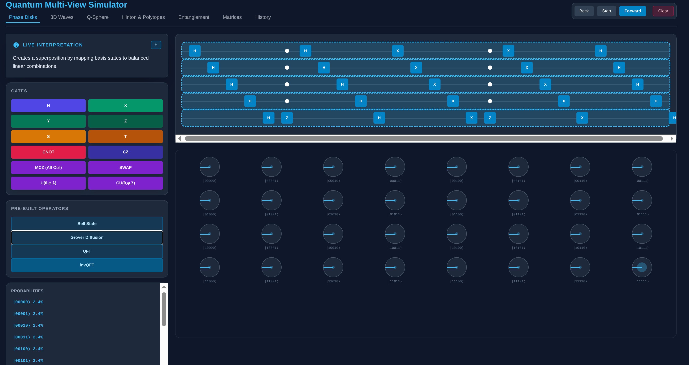
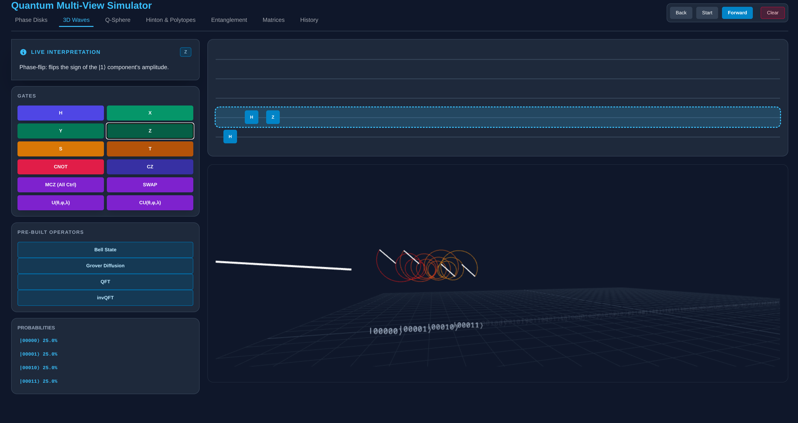

Explore quantum computing using a variety of ways to visualize the
state of the system. Currently supports up to 5 qubits.

The phase disks show each possible state, the amplitude (the amount of
the disk that is filled in) along with the phase angle (the direction
of the line).

The wave view is an animated 3D view of the states as waves. The user
can move around to view the waves from arbitrary points. The white
wave is the "composite wave" which represents the amount of
interference potential in the waves.

The first view shows the waves looking straight down the waves. Note
that the waves are actually 3D "corkscrew" waves. The white line on
each wave indicates the phase angle, similar to the phase disks.  This
screenshot shows two states.

This screenshot shows the waves from the side. One can clearly see
how different states are "out of phase". In this case, they are
180 degrees out of phase.

  

